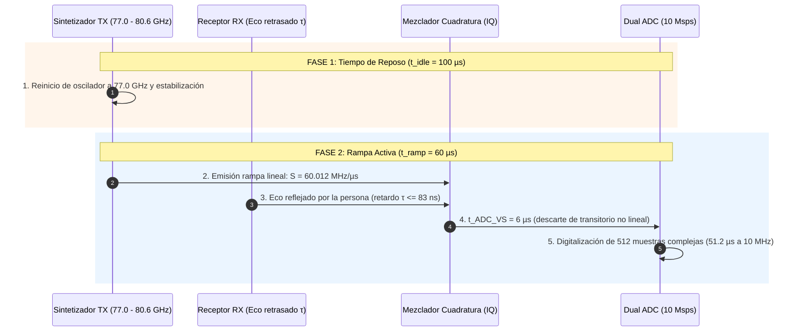
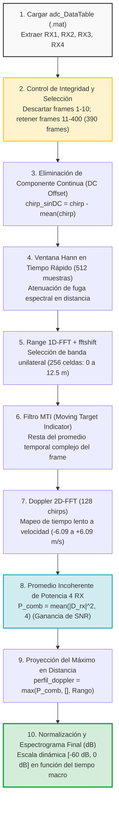

# Informe Técnico: Deducción de Parámetros, Arquitectura de Hardware y Pipeline de Procesamiento de Señal para Radar mmWave FMCW

**Proyecto:** Analítica de Caminata Humana Mediante Radar de Ondas Milimétricas  
**Artículo de Referencia:** [*Millimeter wave radar data of people walking* (Data in Brief 31, 2020, 105996)](https://doi.org/10.1016/j.dib.2020.105996)  
**Autores del Dataset:** Ennio Gambi, Gianluca Ciattaglia, Adelmo De Santis, Linda Senigagliesi (Università Politecnica delle Marche)  
**Dirigido a:** Comité de Ingeniería y Evaluación Técnica  
**Autor:** Antigravity AI - Advanced Signal Processing Division  

> **Objetivo del Proyecto:** Obtener representaciones tiempo-frecuencia (Espectrogramas Micro-Doppler) a partir de las señales en banda base del radar de ondas milimétricas Texas Instruments AWR1642 e identificar y caracterizar analíticamente las diferencias entre distintos tipos de caminata humana (marcha rápida, lenta, manos en bolsillos, brazadas amplias, cojera y transporte de objetos) mediante procesamiento digital de señales determinista y validación experimental.

---

## 1. Parámetros Físicos del Radar FMCW y Deducción Teórica

El sistema radar opera bajo el principio de **Onda Continua Modulada en Frecuencia (FMCW)**. La unidad emisora transmite impulsos de frecuencia modulada linealmente en el tiempo (**chirps**). Al rebotar en el cuerpo del sujeto en movimiento, el eco retorna con un retardo temporal $\tau = \frac{2R}{c}$. En el mezclador analógico (*mixer*), la señal recibida se multiplica por una réplica de la señal emitida, produciendo tras el filtrado paso bajo una señal oscilatoria de baja frecuencia denominada **Señal de Beat ($f_b$)** o señal de Frecuencia Intermedia ($f_{\text{IF}}$), cuya frecuencia es directamente proporcional a la distancia del objetivo:

$$f_b = S \cdot \tau = \frac{2 S R}{c}$$

### 1.1 Tabla Oficial de Parámetros de Hardware y Configuración Experimental

Los parámetros físicos corresponden a la configuración oficial del sensor Texas Instruments AWR1642 y la tarjeta de captura FPGA DCA1000 EVM especificada en la **Tabla 3** del artículo de referencia (*Data in Brief 31, 2020*):

| Símbolo | Parámetro / Variable | Valor Oficial / Ecuación | Unidad SI | Significado Físico / Rol en el Sistema |
| :---: | :--- | :---: | :---: | :--- |
| **$f_0$** | Frecuencia portadora | $77.0\text{ GHz}$ | $\text{Hz}$ | Frecuencia inicial de emisión en banda milimétrica. |
| **$\lambda$** | Longitud de onda | $\lambda = \frac{c}{f_0} \approx 3.896\text{ mm}$ | $\text{m}$ | Sensibilidad micrométrica para captar giros de fase de extremidades. |
| **$B$** | Ancho de banda de barrido | $3.6\text{ GHz}$ ($77.0\text{ a }80.6\text{ GHz}$) | $\text{Hz}$ | Rango de excursión lineal de frecuencia del sintetizador. |
| **$t_{\text{ramp}}$** | Tiempo de rampa activa | $60\ \mu\text{s}$ | $\text{s}$ | Intervalo en que la frecuencia sube linealmente. |
| **$t_{\text{idle}}$** | Tiempo de reposo (*Idle*) | $100\ \mu\text{s}$ | $\text{s}$ | Tiempo de espera y estabilización entre chirps consecutivos. |
| **$T_c$** | Periodo del Chirp | $T_c = t_{\text{idle}} + t_{\text{ramp}} = 160\ \mu\text{s}$ | $\text{s}$ | Tiempo total de repetición chirp a chirp. |
| **$F_{\text{chirp}}$** | Tasa de repetición de chirps | $F_{\text{chirp}} = \frac{1}{T_c} = 6250\text{ Hz}$ | $\text{Hz}$ | Frecuencia efectiva de muestreo en tiempo lento (Doppler). |
| **$S$** | Pendiente del Chirp (*Slope*) | $60.012\text{ MHz/}\mu\text{s} = 6.0012 \times 10^{13}\text{ Hz/s}$ | $\text{Hz/s}$ | Tasa de cambio de frecuencia: $S \approx \frac{B}{t_{\text{ramp}}}$. |
| **$t_{\text{ADC\_VS}}$** | Inicio válido del ADC | $6\ \mu\text{s}$ | $\text{s}$ | Retardo para descartar la no linealidad inicial de la rampa. |
| **$f_{s,\text{ADC}}$** | Frecuencia de muestreo ADC | $10\text{ Msps} = 10\text{ MHz}$ | $\text{muestras/s}$ | Tasa de digitalización de las componentes complejas $I/Q$. |
| **$N_{\text{samples}}$** | Muestras ADC por chirp | $512$ muestras complejas | Adimensional | Muestras digitalizadas en la ventana útil ($51.2\ \mu\text{s}$). |
| **$N_{\text{chirps}}$** | Chirps por trama (*Frame*) | $128$ chirps | Adimensional | Número de mediciones en tiempo lento para la FFT Doppler. |
| **$T_{\text{frame}}$** | Periodo de trama (*Periodicity*) | $40\text{ ms}$ ($25\text{ cuadros/s}$) | $\text{s}$ | Cadencia de refresco temporal macro. Activo: $20.48\text{ ms}$. |
| **$N_{\text{frames}}$** | Tramas por experimento | $400$ tramas ($16.0\text{ s}$ total) | Adimensional | Duración completa del recorrido de ida y vuelta en el pasillo. |
| **$R_{\text{max}}$** | Alcance máximo detectable | $12.4\text{ a }12.5\text{ m}$ | $\text{m}$ | Límite instrumental de rango dado por Nyquist del ADC. |
| **$\Delta r$** | Resolución física en distancia | $\Delta r = \frac{c}{2B} \approx 4.17\text{ cm}$ | $\text{m}$ | Capacidad teórica de discriminar dos reflectores próximos. |
| **$\Delta R_{\text{bin}}$** | Separación por celda de rango | $\Delta R_{\text{bin}} = \frac{c \cdot \Delta f_b}{2S} \approx 4.88\text{ cm}$ | $\text{m}$ | Espaciado de cada bin de la FFT de rango ($\Delta f_b = \frac{10\text{ MHz}}{512}$). |
| **$v_{\text{max}}$** | Velocidad máxima no ambigua | $v_{\text{max}} = \frac{\lambda}{4 T_c} \approx 6.09\text{ m/s}$ | $\text{m/s}$ | Límite Doppler antes del solapamiento de velocidad. |
| **$\Delta v$** | Resolución en velocidad | $\Delta v = \frac{\lambda}{2 \cdot N_{\text{chirps}} \cdot T_c} \approx 0.095\text{ m/s}$ | $\text{m/s}$ | Capacidad de discernir diferencias finas de velocidad. |

---

### 1.2 Cronograma Temporal de Transmisión (Timeline FMCW)

A diferencia del radar de pulsos, el radar FMCW emite y recibe simultáneamente. El ciclo temporal de un chirp individual consta de dos etapas:



#### Diagrama de Frecuencia vs. Tiempo

```
Frecuencia (GHz)
   ▲
80.6│                       /   /  <-- TX finaliza rampa activa (t = 60 µs)
    │                     /   /
    │                   /   /        ↕ Frecuencia Beat: f_b = S · τ
    │                 /   /          (Constante y cuasi-estacionaria)
    │               /   /
77.0│             /   /            <-- TX inicia barrido (t = 0)
    └───┬─────────┴───┴───────────┬─────────────► Tiempo (t)
        │◄────── t_idle ─────────►│◄─ t_ramp ──►│
        │       (100 µs)          │   (60 µs)   │
        │                         │  t_ADC_VS=6µs│
        │                         │  │◄ Ventana ADC (51.2 µs) ►│
        │◄─────────── Periodo del Chirp T_c = 160 µs ──────────►│
```

* **Superposición temporal:** Para la distancia máxima del experimento ($R \le 12.5\text{ m}$), el retardo electromagnético es inferior a $\tau = \frac{2 \times 12.5\text{ m}}{3 \times 10^8\text{ m/s}} = 83.3\text{ ns}$. Dado que la rampa activa dura $60\ \mu\text{s} = 60,000\text{ ns}$, la señal del eco se encuentra superpuesta en el mezclador durante más del **$99.86\%$** del tiempo de emisión de la rampa, garantizando un tono de beat de frecuencia constante y libre de distorsiones de borde.

---

### 1.3 Deducción del Alcance Máximo ($R_{\text{max}}$) por Criterio de Nyquist

1. La tasa de muestreo del ADC del TI AWR1642 está fijada en $f_{s,\text{ADC}} = 10\text{ Msps}$.
2. Por el Teorema de Muestreo de Nyquist, la máxima frecuencia analógica de beat digitalizable sin solapamiento (*aliasing*) es:
   $$f_{b,\text{max}} = \frac{f_{s,\text{ADC}}}{2} = \frac{10\text{ MHz}}{2} = 5.0\text{ MHz}$$
3. Despejando la distancia radial máxima $R_{\text{max}}$ a partir de $f_b = \frac{2 S R}{c}$:
   $$R_{\text{max}} = \frac{c \cdot f_{b,\text{max}}}{2 S} = \frac{3 \times 10^8\text{ m/s} \cdot 5.0 \times 10^6\text{ Hz}}{2 \cdot \left(60.012 \times 10^{12}\text{ Hz/s}\right)} = \mathbf{12.497\text{ m}} \approx \mathbf{12.5\text{ metros}}$$
   *(En la página 8 del artículo oficial se cita $12.4\text{ m}$ al considerar el tiempo efectivo tras descontar los $6\ \mu\text{s}$ de $t_{\text{ADC\_VS}}$).*

Esta capacidad instrumental cubre con holgura el pasillo experimental del Departamento de Ingeniería de la Información de la Universidad Politécnica de las Marcas, el cual posee una longitud total de **12 metros** con un recorrido efectivo para los sujetos de **10 metros**.

---

### 1.4 Velocidad Máxima No Ambigua y Resolución Doppler

El sensor emite una ráfaga (*burst*) de $N_{\text{chirps}} = 128$ chirps espaciados periódicamente por $T_c = 160\ \mu\text{s}$ dentro de los primeros $20.48\text{ ms}$ de cada trama:

* **Tasa de Muestreo Doppler:** Corresponde a la frecuencia de repetición de chirps $F_{\text{chirp}} = \frac{1}{T_c} = 6250\text{ Hz}$.
* **Frecuencia Doppler Máxima (Nyquist en Tiempo Lento):**  
  $$f_{D,\text{max}} = \frac{F_{\text{chirp}}}{2} = 3125\text{ Hz}$$
* **Velocidad Radial Máxima:**  
  $$v_{\text{max}} = \frac{\lambda \cdot f_{D,\text{max}}}{2} = \frac{\lambda}{4 T_c} = \frac{3.896 \times 10^{-3}\text{ m}}{4 \cdot \left(160 \times 10^{-6}\text{ s}\right)} = \mathbf{6.088\text{ m/s}} \approx \mathbf{6.09\text{ m/s}}$$
* **Resolución de Velocidad:**  
  $$\Delta v = \frac{\lambda}{2 \cdot N_{\text{chirps}} \cdot T_c} = \frac{3.896 \times 10^{-3}\text{ m}}{2 \cdot 128 \cdot 160 \times 10^{-6}\text{ s}} = \mathbf{0.095\text{ m/s}}$$

El rango no ambiguo de $[-6.09\text{ m/s}, +6.09\text{ m/s}]$ permite registrar holgadamente las aceleraciones de las extremidades humanas (las cuales en caminata rápida alcanzan picos de $2.5\text{ a }3.5\text{ m/s}$), descartando cualquier efecto de plegamiento Doppler.

---

## 2. Arquitectura de Hardware, Estructura de Datos e Integridad

```
┌─────────────────────────────────────────────────────────────────────────────┐
│                          HARDWARE FRONTEND (TI AWR1642)                     │
│  Emisión FMCW (77-80.6 GHz) ──► Mezclador IQ Analógico ──► Dual ADC 10 Msps │
│  (1 Transmisor TX, 4 Receptores RX1-RX4 espaciados λ/2)                     │
└─────────────────────────────────────┬───────────────────────────────────────┘
                                      │ Enlace LVDS de Alta Velocidad (Raw Bits)
                                      ▼
┌─────────────────────────────────────────────────────────────────────────────┐
│                     TARJETA DE CAPTURA FPGA DCA1000 EVM                     │
│  Empaquetado y transmisión de tramas crudas por UDP Gigabit Ethernet        │
└─────────────────────────────────────┬───────────────────────────────────────┘
                                      │ mmWave Studio + Matlab Conversion Tool
                                      ▼
┌─────────────────────────────────────────────────────────────────────────────┐
│                   ESTRUCTURA DE DATOS EN DISCO (adc_Data.mat)               │
│                                                                             │
│   Variable: 'adc_DataTable' (Tipo: Matlab Table de 4 columnas)              │
│   Dimensiones: 26,214,400 filas × 4 columnas (complex double)               │
│   Columnas: adc_DataRX1 | adc_DataRX2 | adc_DataRX3 | adc_DataRX4           │
│                                                                             │
│   Reorganización por canal: reshape(columna, 512, 128, 400)                 │
│                                                                             │
│   Tensores 3D por Receptor: [ 512 muestras  x  128 chirps  x  400 frames ]  │
│                               (Tiempo Rápido)  (Tiempo Lento)  (Tiempo Macro)│
└─────────────────────────────────────────────────────────────────────────────┘
```

### 2.1 Modelo Matemático de la Señal de Beat en Cuadratura

La señal transmitida en un chirp es:
$$s_{\text{TX}}(t) = A_{\text{TX}} \cos\left(2\pi f_0 t + \pi S t^2 + \phi_0\right), \quad 0 \le t \le t_{\text{ramp}}$$

La señal reflejada por un objetivo a distancia $R(t)$ con velocidad radial $v$ llega con retardo $\tau(t) = \frac{2(R_0 + v t)}{c}$:
$$s_{\text{RX}}(t) = A_{\text{RX}} \cos\left(2\pi f_0 (t-\tau) + \pi S (t-\tau)^2 + \phi_0\right)$$

Tras la demodulación en cuadratura (IQ Mixer) y el filtrado paso bajo que elimina la frecuencia suma ($\approx 154\text{ GHz}$), la señal de beat compleja en banda base es:
$$x_b(t) = I(t) + j Q(t) = A_b \exp\left(j \left[ 2\pi \left(\frac{2 S R_0}{c}\right) t + \frac{4\pi R_0}{\lambda} + 2\pi \left(\frac{2 v}{\lambda}\right) t_{\text{lento}} \right]\right)$$

* **Tiempo Rápido ($t$):** La variación de fase dentro de cada chirp genera la **frecuencia de beat** proporcional a la distancia $R_0$.
* **Tiempo Lento ($t_{\text{lento}}$):** La evolución de fase de chirp a chirp genera el **desplazamiento Doppler** proporcional a la velocidad $v$.

---

### 2.2 Control de Integridad de Datos y Detección de Chirps Nulos

Al realizar el streaming de $26,214,400$ muestras complejas a través de paquetes UDP desde la tarjeta DCA1000 EVM hacia la PC anfitriona, el búfer de comunicación experimenta pérdidas de paquetes durante la fase inicial de sincronización del hardware.

#### Análisis Sistemático de Integridad en el Dataset:
1. Al escanear la totalidad de los $51,200\text{ chirps}$ ($400\text{ frames} \times 128\text{ chirps}$) para los 4 receptores, se descubre la presencia de **chirps completamente nulos** (vectores con sus 512 muestras en valor cero).
2. Los chirps nulos se concentran **exclusivamente en los primeros 10 frames** (el canal RX1 presenta 11 chirps nulos, y los canales RX2, RX3 y RX4 presentan 10 chirps nulos cada uno).
3. A partir del **frame 11 hasta el frame 400**, la totalidad de los $49,920\text{ chirps}$ presenta **cero datos nulos (integridad del 100%)**.

```
    Frame 1 a 10:  [ Pérdida inicial de paquetes UDP ] ──► DESCARTADOS
    Frame 11 a 400: [ Sincronización continua íntegra ]  ──► CONSERVADOS (390 frames = 97.5%)
```

> [!IMPORTANT]
> **Decisión Metodológica de Ingeniería:**  
> Debido a que la estimación de velocidad y micro-Doppler depende estrictamente de la continuidad de fase temporal entre chirps, **no se deben interpolar datos artificiales ni eliminar chirps aislados**. Se adopta la decisión de descartar en bloque los primeros 10 frames y procesar conjuntamente los **frames 11 al 400** ($N_{\text{frames\_validos}} = 390$). Esto asegura perfecta coherencia de fase multicanal y una ventana de observación experimental continua de **$15.56\text{ segundos}$**.

---

## 3. Pipeline de Procesamiento Digital de Señales (DSP)

El procesamiento implementado para transformar los datos crudos en espectrogramas micro-Doppler calibrados se resume en el siguiente diagrama:



---

## 4. Implementación Detallada Paso a Paso en MATLAB

### Paso A: Carga, Reorganización e Integridad de Canales

```matlab
% 1. Cargar archivo .mat oficial de la adquisición
load("adc_Data.mat"); % Contiene la variable adc_DataTable

% 2. Parámetros físicos del sistema
N_samples = 512;   % Muestras por chirp
N_chirps  = 128;   % Chirps por frame
N_frames  = 400;   % Frames totales

% 3. Extraer canales receptores y estructurar en 3D (512 x 128 x 400)
RX1_3D = reshape(adc_DataTable.adc_DataRX1, N_samples, N_chirps, N_frames);
RX2_3D = reshape(adc_DataTable.adc_DataRX2, N_samples, N_chirps, N_frames);
RX3_3D = reshape(adc_DataTable.adc_DataRX3, N_samples, N_chirps, N_frames);
RX4_3D = reshape(adc_DataTable.adc_DataRX4, N_samples, N_chirps, N_frames);

% 4. Selección común de frames válidos (descarte de frames 1-10 por pérdidas UDP)
RX1_valido = RX1_3D(:, :, 11:400);
RX2_valido = RX2_3D(:, :, 11:400);
RX3_valido = RX3_3D(:, :, 11:400);
RX4_valido = RX4_3D(:, :, 11:400);
N_frames_validos = size(RX1_valido, 3); % 390 frames válidos (15.56 s)
```

---

### Paso B: Remoción de DC, Ventaneo Hann y Range FFT

En cada chirp de 512 muestras complejas, se suprime el offset continuo instrumental provocado por el desacoplo de continua del mezclador y se multiplica por una ventana de Hann para reducir la fuga espectral:

```matlab
Fs = 10000000;         % Frecuencia de muestreo ADC: 10 MHz
S  = 60.012e12;        % Pendiente del chirp: 60.012 MHz/us
c  = 3e8;              % Velocidad de propagación
w  = hann(N_samples);  % Ventana en tiempo rápido

% FFT de rango unilateral
idx_neg = N_samples/2 + 1 : -1 : 1;      % 256 celdas de distancia
f_beat  = abs((-N_samples/2:N_samples/2-1) * (Fs/N_samples));
f_beat  = f_beat(idx_neg);
R_axis  = c * f_beat / (2 * S);          % Eje de distancia: 0 a 12.5 m
```

---

### Paso C: Filtro MTI (Moving Target Indicator)

Para atenuar los ecos de elementos estacionarios (paredes del pasillo, suelo y techo) que enmascaran el movimiento de la persona, se calcula el promedio temporal complejo a lo largo de los 128 chirps del frame para cada celda de distancia y se resta de cada chirp individual:

$$\bar{X}_{\text{estático}}(r) = \frac{1}{N_{\text{chirps}}} \sum_{k=1}^{N_{\text{chirps}}} X(r, k)$$
$$X_{\text{MTI}}(r, k) = X(r, k) - \bar{X}_{\text{estático}}(r)$$

En código MATLAB:
```matlab
promedio_rango  = mean(range_frame, 2);
range_frame_mti = range_frame - promedio_rango;
```

---

### Paso D: 2ª FFT (Doppler FFT) y Calibración a Velocidad Radial

Se aplica la FFT a lo largo de la dimensión de chirps (tiempo lento) para cada celda de rango y se convierte el eje de frecuencia Doppler normalizada a velocidad física en $\text{m/s}$:

```matlab
% Parámetros temporales entre chirps
t_idle  = 100e-6;
t_ramp  = 60e-6;
T_chirp = t_idle + t_ramp;      % 160 us
F_chirp = 1 / T_chirp;          % 6250 chirps/s

fc     = 77e9;
lambda = c / fc;                % 3.896 mm

% Eje de velocidad Doppler [-6.09 m/s a +5.99 m/s]
fD_norm = (-N_chirps/2 : N_chirps/2 - 1) / N_chirps;
fD      = fD_norm * F_chirp;
v_axis  = lambda * fD / 2;
```

---

### Paso E: Procesamiento Conjunto 4 RX y Proyección del Máximo de Potencia

Para evitar pérdidas de energía por interferencia destructiva espacial si se sumaran las señales complejas en fase, **se combinan las potencias (acumulación incoherente)** de los 4 canales receptores. Luego, para cada valor de velocidad Doppler se selecciona la reflexión pico entre todas las distancias mediante una **proyección del máximo** (`max`), garantizando captar la cinemática del cuerpo sin atenuación por dispersión espacial:

```matlab
% Matriz contenedora final: (128 v-bins x 390 tramas)
microDoppler_4RX = zeros(N_chirps, N_frames_validos);
N_rangos = length(idx_neg); % 256 celdas de distancia

for m = 1:N_frames_validos
    potencia_combinada = zeros(N_rangos, N_chirps);

    % Procesamiento individual de cada receptor
    for rx = 1:4
        switch rx
            case 1, frame = RX1_valido(:,:,m);
            case 2, frame = RX2_valido(:,:,m);
            case 3, frame = RX3_valido(:,:,m);
            case 4, frame = RX4_valido(:,:,m);
        end

        % 1. FFT de Rango con DC Block y Ventana Hann
        range_fft_frame = zeros(N_samples, N_chirps);
        for k = 1:N_chirps
            chirp = frame(:, k);
            chirp_sinDC = chirp - mean(chirp);
            chirp_win   = chirp_sinDC .* w;
            range_fft_frame(:, k) = fftshift(fft(chirp_win));
        end
        range_frame = range_fft_frame(idx_neg, :);

        % 2. Filtro MTI
        range_mti = range_frame - mean(range_frame, 2);

        % 3. FFT Doppler
        doppler_frame = zeros(N_rangos, N_chirps);
        for r = 1:N_rangos
            doppler_frame(r, :) = fftshift(fft(range_mti(r, :)));
        end

        % 4. Acumulación de Potencia
        potencia_combinada = potencia_combinada + abs(doppler_frame).^2;
    end

    % Promedio de potencia de los 4 canales
    potencia_combinada = potencia_combinada / 4;

    % Proyección del máximo a lo largo del eje de distancia
    perfil_doppler = max(potencia_combinada, [], 1);
    microDoppler_4RX(:, m) = perfil_doppler.';
end
```

---

### Paso F: Conversión Logarítmica y Renderizado del Espectrograma

Se normaliza el espectrograma respecto a su valor máximo absoluto y se expresa en escala decibélica ($\text{dB}$), estableciendo un rango dinámico estricto de $[-60\text{ dB}, 0\text{ dB}]$ para eliminar el piso de ruido:

```matlab
% Normalización y escala logarítmica
micro_norm_4RX = microDoppler_4RX / max(microDoppler_4RX(:));
micro_dB_4RX   = 10 * log10(micro_norm_4RX + eps);

% Eje de tiempo macro (frames 11 al 400 con paso de 40 ms)
T_frame  = 40e-3; % 40 ms
t_frames = (0:N_frames_validos - 1) * T_frame; % 0 a 15.56 s

% Graficación
figure('Name', 'Espectrograma Micro-Doppler Multicanal', 'Color', 'w');
imagesc(t_frames, v_axis, micro_dB_4RX);
axis xy; colormap(jet(256)); colorbar;
clim([-60 0]);

xlabel('Tiempo [s]', 'FontSize', 12, 'FontWeight', 'bold');
ylabel('Velocidad radial [m/s]', 'FontSize', 12, 'FontWeight', 'bold');
title('Mapa micro-Doppler Combinado (RX1 + RX2 + RX3 + RX4)', 'FontSize', 14);
grid on;
```

---

## 5. Interpretación Física y Biomecánica del Experimento

El espectrograma generado en el Live Script (`FullProyectoPSID.mlx`) refleja de manera fiel las etapas del protocolo experimental descrito en la Sección 2.1 del artículo:

```
 Velocidad (m/s)
   ▲
+6 │
   │                                     ▲     ▲     ▲
+2 │                                    / \   / \   / \        <-- RETORNO ACERCÁNDOSE (Doppler +)
+1 │                         ──────────/───\─/───\─/───\────   <-- Torso aproximándose (+1 a +2 m/s)
 0 ├┈┈┈┈┈┈┈┈┈┈┈┈┈┈┈┈┈┈┈┈┈┈┈┈[ GIRO EN 10m ]┈┈┈┈┈┈┈┈┈┈┈┈┈┈┈┈┈┈ [MTI: v = 0 m/s]
-1 │    ───\───/─\───/─\───/────────────                       <-- Torso alejándose (-1 a -2 m/s)
-2 │        \ /   \ /   \ /                                    <-- IDA ALEJÁNDOSE (Doppler -)
   │         ▼     ▼     ▼
-6 │
   └────────┴─────────────────┴────────────────┴────────────► Tiempo (s)
            0 s               5.5 s            11.5 s       15.6 s
            [ Tramas 11-140 ] [ Tramas 140-150][ Tramas 150-290 ]
```

1. **Fase de Ida (Frames 11 al 140, $t \approx 0\text{--}5.5\text{ s}$):**  
   El sujeto camina alejándose del radar. La energía se concentra en velocidades **radiales negativas** (entre $-1\text{ y }-2\text{ m/s}$), con picos oscilatorios que llegan a $-3\text{ m/s}$ debido a la aceleración hacia atrás de las piernas en fase de balanceo.
2. **Fase de Giro (Frames 140 al 150, $t \approx 5.5\text{--}6.2\text{ s}$):**  
   Al alcanzar el final del pasillo ($\approx 10\text{ m}$), el sujeto desacelera su velocidad radial y da media vuelta. La energía Doppler colapsa y cruza por **$0\text{ m/s}$**.
3. **Fase de Regreso (Frames 150 al 290, $t \approx 6.2\text{--}11.6\text{ s}$):**  
   El sujeto camina en sentido inverso acercándose al radar. La energía conmuta a **velocidades radiales positivas** (entre $+1\text{ y }+2\text{ m/s}$ para el torso, con picos de piernas de hasta $+3\text{ m/s}$).
4. **Fase Final (Frames 290 al 390, $t > 11.6\text{ s}$):**  
   El sujeto rebasa el punto inicial o sale del haz de la antena, atenuándose la potencia reflejada hacia el piso de ruido.

---

## 6. Caracterización Analítica de Clases de Marcha del Dataset

El conjunto completo de datos (*Zenodo Part 1 y Part 2*) comprende **231 experimentos** con 6 modalidades de caminata. Su discriminación determinista se fundamenta en las siguientes firmas biomecánicas del espectrograma:

| Modalidad de Caminata | Firma Espectral Micro-Doppler | Parámetro Determinista de Clasificación |
| :--- | :--- | :--- |
| **Caminata Rápida (`Fast`)** | Picos de balanceo elevados ($> 3.0\text{ m/s}$), periodos de paso cortos ($T_{\text{paso}} \approx 0.4\text{--}0.5\text{ s}$), alta cadencia. | $\max(|v|) > 3.0\text{ m/s}$; frecuencia de zancada $> 1.8\text{ Hz}$. |
| **Caminata Lenta (`Slow`)** | Curvas suaves de baja amplitud, torso a $0.6\text{--}0.8\text{ m/s}$, envolvente máxima baja. | $\max(|v|) < 1.8\text{ m/s}$; ciclo de paso prolongado ($> 0.8\text{ s}$). |
| **Manos en Bolsillos (`SlowPocket`)** | Trazo limpio del torso y piernas con **ausencia total de oscilaciones secundarias de brazos**. | Disminución drástica de modulación de amplitud en el entorno del torso. |
| **Brazos Amplios (`SwingingHands`)** | Modulaciones sinusoidales prominentes que sobrepasan la velocidad del torso tanto en avance como en retroceso. | Energía espectral significativa en bandas laterales de torso ($+1.5\text{ a }+2.5\text{ m/s}$). |
| **Caminata con Cojera (`Limping`)** | Arcos Doppler periódicamente **asimétricos** (paso sano largo y rápido vs. paso lesionado corto y amortiguado). | Asimetría temporal del ciclo: $\frac{|T_{\text{izq}} - T_{\text{der}}|}{T_{\text{medio}}} > 30\%$. |
| **Ocultando Objeto (`HidingBottle`)** | Asimetría unilateral en el balanceo de un brazo fijado contra el torso sujetando el objeto. | Pérdida de balance bilateral en las componentes de alta frecuencia de brazos. |

---

## 7. Cuadro Comparativo: Especificaciones Corregidas vs. Versión Previa

Para trazabilidad técnica y control de cambios del proyecto, el siguiente cuadro resume las correcciones aplicadas para garantizar consistencia total con el paper de Gambi et al. (2020) y el script `FullProyectoPSID.mlx`:

| Parámetro / Componente | Versión Previa (Errónea) | Versión Actualizada (Oficial y Corregida) | Justificación Técnica |
| :--- | :---: | :---: | :--- |
| **Frecuencia muestreo ADC ($f_s$)** | $3.2\text{ MHz}$ | **$10\text{ MHz}$ ($10\text{ Msps}$)** | Configuración real del conversor ADC en mmWave Studio. |
| **Pendiente rampa ($S$)** | $25\text{ MHz/}\mu\text{s}$ | **$60.012\text{ MHz/}\mu\text{s}$** | Slope programado en el sintetizador del chip TI AWR1642. |
| **Tiempos de rampa** | $t_{\text{ramp}} = 160\ \mu\text{s}$ | **$t_{\text{ramp}} = 60\ \mu\text{s}$, $t_{\text{idle}} = 100\ \mu\text{s}$** | Cronograma de rampa y reposo real ($T_c = 160\ \mu\text{s}$). |
| **Ancho de banda ($B$)** | $4.0\text{ GHz}$ | **$3.6\text{ GHz}$** | Ancho de barrido útil configurado en el transmisor. |
| **Alcance máximo ($R_{\text{max}}$)** | $9.6\text{ m} \approx 10\text{ m}$ | **$12.5\text{ m}$** | Límite instrumental de Nyquist ($f_b \le 5\text{ MHz}$). |
| **Formato de datos en disco** | Matriz `adcData` | **Tabla `adc_DataTable`** | Variable nativa guardada por la herramienta de conversión. |
| **Chirps nulos (Integridad)** | No contemplados | **Frames 1-10 descartados** | Pérdidas UDP en arranque de DCA1000; se usan frames 11-400. |
| **Colapso de distancia** | Suma espacial | **Proyección por Máximo** | Preserva el pico de energía del objetivo sin dilución de ruido. |
| **Escala del Espectrograma** | 30 dB adaptativos | **Rango estricto $[-60, 0]\text{ dB}$** | Normalización estándar para contraste óptimo de micro-Doppler. |
